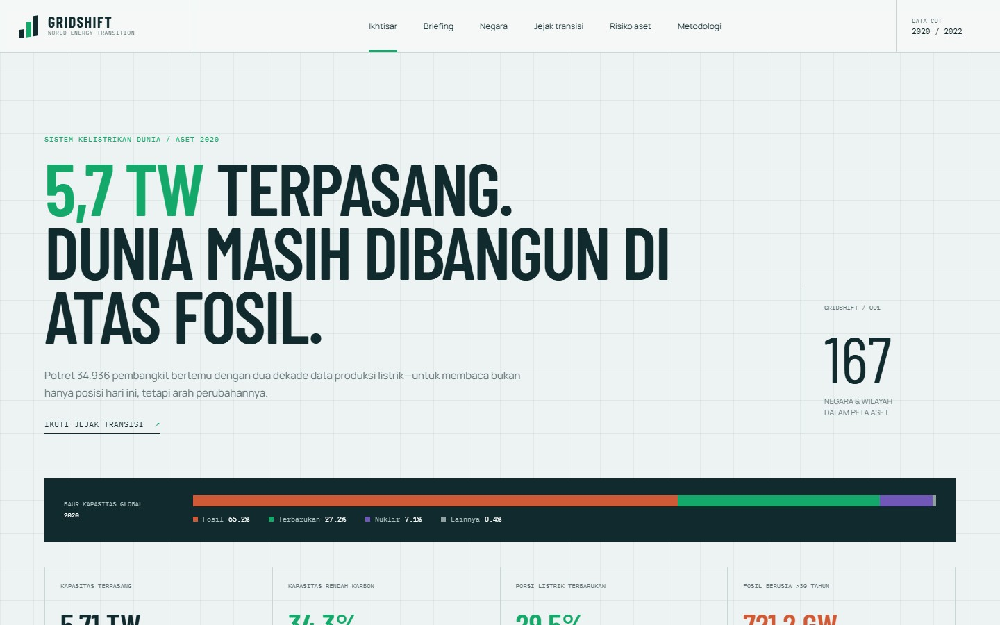
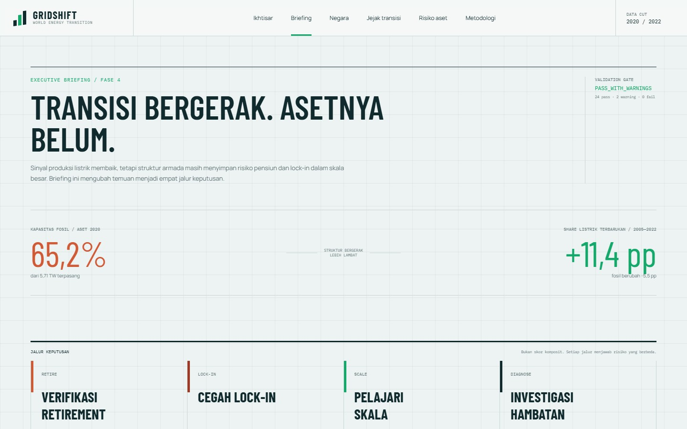

# GRIDSHIFT — Global Energy Transition Dashboard

Dashboard analitik untuk membaca struktur pembangkit listrik dunia, membandingkan bauran energi antarnegara, mengikuti perubahan produksi listrik, dan mengidentifikasi indikasi risiko pada armada pembangkit fosil.

GRIDSHIFT dibangun untuk menjawab dua pertanyaan yang berbeda:

1. **Seperti apa struktur aset pembangkit dunia?**
2. **Seberapa cepat produksi listrik bergerak menuju energi terbarukan?**

Keduanya tidak dipaksakan menjadi satu ukuran. Kapasitas terpasang berasal dari snapshot aset WRI dengan reference year 2020, sedangkan perubahan historis berasal dari data produksi listrik country-year OWID untuk periode pembanding 2005–2022.



## 1. Tentang proyek

Transisi energi sering dijelaskan menggunakan satu persentase tanpa menunjukkan skala sistem, umur aset, coverage data, atau perbedaan antara kapasitas dan produksi listrik. GRIDSHIFT menggabungkan ketiga lapisan tersebut dalam satu alur analitik yang dapat direproduksi:

- **Struktur:** lokasi, bahan bakar, kapasitas, dan umur indikatif pembangkit.
- **Perubahan:** perkembangan renewable, fossil, nuclear, dan low-carbon electricity share.
- **Konteks:** populasi, region, income group, coverage, serta batas metodologis.
- **Keputusan:** pemisahan antara peluang retirement aset tua, risiko lock-in aset muda, scalable transition, dan sistem yang perlu dianalisis lebih lanjut.

Proyek ini ditujukan untuk analis energi, peneliti, organisasi lingkungan, investor, pembuat kebijakan, dan pembaca umum yang membutuhkan gambaran global tanpa menyembunyikan keterbatasan data.

## 2. Insight utama

### Dunia masih dibangun di atas fosil

Snapshot aset memetakan **34.936 pembangkit** pada 167 negara dan wilayah dengan total kapasitas **5.706,98 GW**. Komposisinya:

- **65,23%** kapasitas fosil.
- **27,20%** kapasitas renewable.
- **34,34%** kapasitas low-carbon, yaitu renewable + nuclear.

Angka tersebut menggambarkan kapasitas terpasang pada snapshot WRI, bukan jumlah listrik yang benar-benar diproduksi.

### Produksi listrik terbarukan meningkat

Pada tingkat dunia, renewable electricity share berubah dari **18,10% pada 2005** menjadi **29,47% pada 2022**. Kenaikannya mencapai **11,37 percentage points**, sementara fossil electricity share turun **5,47 percentage points** pada periode yang sama.

Perbedaan besarnya perubahan menunjukkan bahwa pertumbuhan terbarukan tidak dapat dibaca sebagai penggantian fosil satu banding satu. Permintaan listrik, nuklir, perdagangan listrik, dan komponen produksi lain juga memengaruhi bauran.

### Aset tua menciptakan jendela retirement

Sekitar **721,2 GW** kapasitas fosil tercatat berumur lebih dari 30 tahun. Amerika Serikat memiliki volume terbesar, yaitu **363,9 GW**, dengan coverage umur fosil **99,8%**.

Temuan ini merupakan indikasi awal untuk investigasi retirement, bukan bukti bahwa seluruh aset masih beroperasi atau akan segera ditutup.

### Batu bara muda menciptakan risiko lock-in

Pada snapshot 2020:

- China memiliki **631,7 GW** kapasitas batu bara berumur kurang dari 15 tahun.
- India memiliki **126,5 GW**.

Tanpa perubahan utilisasi, refinancing, retrofit, atau retirement dini, armada muda dapat memperpanjang ketergantungan fosil selama beberapa dekade.

### Momentum perlu dibandingkan pada skala yang sebanding

Dalam peer group negara dengan kapasitas aset minimal 50 GW, United Kingdom mencatat kenaikan renewable electricity share **37,36 percentage points** pada 2005–2022. Pada sisi lain, Iran mencatat perubahan **−3,90 percentage points**.

Peer group ini digunakan agar pembelajaran transisi tidak hanya berasal dari sistem listrik yang sangat kecil. Angka tersebut tetap bersifat deskriptif dan tidak menjelaskan penyebab kebijakan secara kausal.

## 3. Fitur dashboard

Dashboard memiliki enam area analisis:

| Halaman | Fungsi |
|---|---|
| **Ikhtisar** | Tesis global, KPI, energy-mix ribbon, peta kapasitas, dan komposisi bahan bakar |
| **Briefing** | Empat jalur keputusan: retirement, lock-in, scalable transition, dan diagnosis hambatan |
| **Negara** | Perbandingan kapasitas absolut, share energi, ranking, dan filter region |
| **Jejak transisi** | Perbandingan renewable electricity share 2005–2022 dan transition momentum |
| **Risiko aset** | Umur armada fosil, aset >30 tahun, batu bara <15 tahun, serta coverage |
| **Metodologi** | Definisi KPI, provenance, coverage, asumsi, dan guardrail interpretasi |

Interaksi utama mencakup filter region, pilihan metrik, pemilihan maksimal lima seri negara, zoom peta, tooltip, peer-group ranking, dan filter kapasitas fosil minimum.



## 4. Data yang digunakan

| Sumber | Peran | Snapshot/cutoff | Coverage proyek |
|---|---|---|---:|
| [WRI Global Power Plant Database](https://github.com/wri/global-power-plant-database) | Aset, kapasitas, lokasi, bahan bakar, dan commissioning year | Versi 1.3.0, commit `7a91cfbb2a4e272597acbc00506d61fc1ec73b3d` | 34.936 aset; 167 negara/wilayah |
| [Our World in Data Energy Data](https://github.com/owid/energy-data) | Produksi listrik, electricity mix, intensitas karbon, dan data per kapita | Commit `7e387a16f70a510e433f8aac7efeac6faa1e5059` | 14.843 entity-year; 1900–2025 |
| [World Bank Open Data](https://data.worldbank.org/) | Populasi 2020, region, dan income group | API v2, diakses 29 September 2026 | 163 dari 167 kode aset cocok |
| [World Atlas / Natural Earth](https://github.com/topojson/world-atlas) | Basemap visualisasi dunia | `world-atlas` 2.x | Konteks spasial frontend |

### Pemisahan fungsi sumber

- **WRI** hanya digunakan untuk struktur aset dan kapasitas.
- **OWID** digunakan untuk perubahan historis produksi listrik.
- **World Bank** digunakan untuk metadata negara dan normalisasi populasi.

Baris agregat `OWID_WRL` diperlakukan sebagai benchmark terpisah. Baris tersebut tidak dijumlahkan bersama negara dan tidak masuk ranking negara.

Data mentah tidak dilacak dalam Git karena ukurannya besar. Pipeline mengunduh snapshot dari commit yang dipatok, mencatat metadata, dan memverifikasi integritas file menggunakan SHA-256.

## 5. Tech stack

| Lapisan | Teknologi | Fungsi |
|---|---|---|
| Data ingestion & transformation | Python, pandas | Download, profiling, cleaning, mapping, feature engineering, dan validasi |
| Data warehouse | PostgreSQL | Star schema, fact/dimension tables, analytical views, dan quality checks |
| Query layer | SQL | KPI, ranking, age bands, fuel mix, coverage, momentum, dan rekonsiliasi |
| API | Node.js, Express, `pg` | Endpoint read-only yang mengakses PostgreSQL menggunakan parameterized queries |
| Frontend | React, Vite | Single-page analytical application dan development workflow |
| Visualisasi | Apache ECharts | Peta, line chart, bar chart, scatter plot, dan interactive tooltip |
| Geospasial | TopoJSON Client, World Atlas | Basemap dan transformasi geometri dunia |
| Tipografi | Fontsource | Distribusi font lokal tanpa ketergantungan CDN runtime |
| Testing | Playwright | Pengujian end-to-end desktop/mobile, navigasi, API, console, dan overflow |

Environment pengembangan proyek ini menggunakan Python 3.10+, Node.js 22+, PostgreSQL, dan browser Chromium untuk pengujian.

## 6. Arsitektur

```text
WRI Global Power Plant Database
OWID Energy Data
World Bank Open Data
             │
             ▼
   Python ingestion & validation
             │
             ▼
 data/processed + data/analytics
             │
             ▼
 PostgreSQL: energy_core + energy_analytics
             │
             ▼
       Express read-only API
             │
             ▼
       React + Apache ECharts
```

### Model data utama

- `energy_core.fact_power_plant`: satu baris per aset pembangkit.
- `energy_core.fact_country_energy_year`: satu baris per entitas dan tahun.
- `energy_core.dim_country`: negara, region, income group, dan populasi.
- `energy_core.dim_fuel`: fuel group serta fossil/renewable/nuclear/low-carbon flags.
- `energy_core.dim_energy_entity`: penghubung negara dan seri historis.
- `energy_analytics.*`: view siap-dashboard untuk KPI, ranking, risiko, coverage, dan momentum.

API tidak mengirim kredensial database ke browser. Semua query dinamis menggunakan parameter terikat, validasi input, batas jumlah hasil, dan pesan error yang tidak mengekspos detail PostgreSQL.

## 7. Design system

Identitas visual GRIDSHIFT menggunakan konsep **“grid operator’s atlas”**: gabungan panel operasi jaringan listrik, peta teknis, dan briefing analitik.

### Palet

| Token | Warna | Makna |
|---|---|---|
| Ocean ink | `#102A2E` | Teks utama, navigasi, dan panel keputusan |
| Cool fog | `#EDF2F2` | Latar utama |
| Grid line | `#C8D6D6` | Struktur, pembatas, dan reference grid |
| Renewable emerald | `#14A86B` | Renewable energy dan perubahan positif |
| Fossil ember | `#D15A36` | Fossil capacity dan risiko aset |
| Nuclear violet | `#7157B7` | Nuclear capacity |
| Water blue | `#1F6F8B` | Data bars dan konteks analitik |
| Solar gold | `#E5B940` | Focus state dan perhatian metodologis |

### Tipografi

- **Barlow Condensed:** judul, angka besar, dan pernyataan analitik.
- **Manrope:** body copy dan navigasi.
- **IBM Plex Mono:** label data, periode, provenance, dan utility text.

### Prinsip visual

- Warna menyampaikan kategori energi, bukan dekorasi.
- Energy-mix ribbon menunjukkan komposisi sebelum pengguna membaca KPI individual.
- Decision board memisahkan jenis tindakan agar risiko retirement tidak tercampur dengan lock-in.
- Hairline grid dan data stamp memperlihatkan hubungan antara angka, periode, dan sumber.
- Layout responsif tersedia untuk desktop dan mobile.
- Keyboard focus terlihat dan animasi menghormati `prefers-reduced-motion`.
- Unit, periode, dan coverage ditempatkan dekat dengan metrik yang dijelaskan.

## 8. Metodologi dan guardrail analisis

Keputusan metodologis utama:

- Reference year umur aset: **2020**.
- Low carbon: **renewable + nuclear**.
- Periode comparison default: **2005–2022**.
- Ranking share kapasitas: hanya negara dengan total kapasitas minimal **1 GW**.
- Executive peer group sistem besar: minimal **50 GW**.
- Aset fosil tua: `plant_age_years > 30`.
- Batu bara muda: `plant_age_years < 15`.
- Transition momentum: perubahan renewable electricity share dibagi 17 tahun.

Kapasitas (MW/GW), produksi listrik (TWh), jumlah pembangkit, serta perubahan percentage points selalu diperlakukan sebagai konsep yang berbeda.

Dokumentasi lebih lanjut:

- [Metodologi Fase 2](docs/phase2-methodology.md)
- [Arsitektur dashboard Fase 3](docs/phase3-dashboard.md)
- [Validasi dan komunikasi Fase 4](docs/phase4-validation-communication.md)
- [Data dictionary](docs/data-dictionary.md)

## 9. Validasi dan kualitas data

Validation gate Fase 4 menghasilkan:

| Status | Jumlah |
|---|---:|
| Pass | 24 |
| Warning | 2 |
| Fail | 0 |

Pemeriksaan mencakup:

- Checksum snapshot WRI dan OWID.
- Rekonsiliasi jumlah baris dan kapasitas dari sumber, mart, hingga PostgreSQL.
- Keunikan `plant_id` dan grain entity-year.
- Foreign-key relationship tanpa orphan.
- Rekonsiliasi rollup country, fuel, region, dan age band ke total global.
- Kontrak filter country dan fuel.
- Ranking eligibility dan endpoint consistency.
- Audit duplicate asset signature dan perlakuan agregat `World`.

Dua warning yang diterima dan ditampilkan secara eksplisit:

1. ATA, ESH, GUF, dan TWN tidak cocok dengan metadata World Bank.
2. Renewable-share coverage 2025 baru mencakup 90 entitas sehingga tidak dipakai sebagai endpoint ranking default.

Pengujian browser terakhir meluluskan **4/4 skenario** desktop dan mobile tanpa console error atau horizontal overflow.

## 10. Menjalankan proyek

### Prasyarat

- Python 3.10 atau lebih baru.
- PostgreSQL dengan utilitas `psql`.
- Node.js 22 atau lebih baru.
- npm.

### Python environment

```powershell
python -m venv .venv
.venv\Scripts\Activate.ps1
python -m pip install -r requirements.txt
```

### Konfigurasi PostgreSQL

Salin template environment pada root proyek:

```powershell
Copy-Item .env.example .env
```

Kemudian isi kredensial lokal pada `.env`:

```dotenv
PGHOST=localhost
PGPORT=5432
PGUSER=postgres
PGPASSWORD=your_postgresql_password
PGDATABASE=energy_transition
```

`.env` telah diabaikan oleh Git dan tidak boleh dimasukkan ke repository. Detail koneksi tersedia di [PostgreSQL setup](docs/postgresql-setup.md).

### Menjalankan pipeline data

```powershell
# Fase 1 — aset WRI
python src/download_wri.py
python src/run_phase1.py

# Fase 2 — World Bank, model aset, dan PostgreSQL
python src/download_world_bank.py
python src/run_phase2.py
python src/load_postgres.py
python src/verify_postgres.py

# Fase 3 — OWID dan model historis
python src/download_owid.py
python src/run_phase3.py
python src/load_phase3_postgres.py

# Fase 4 — final validation dan executive communication
python src/run_phase4.py
```

### Menjalankan dashboard

```powershell
cd web
npm install
npm run dev
```

Buka `http://127.0.0.1:3000`.

React HMR ditangani oleh Vite. Untuk mengembangkan kode Express dengan watcher terbatas:

```powershell
npm run dev:watch
```

### Build dan test

```powershell
cd web
npm run check
npx playwright install chromium
npm run test:e2e
```

Mode produksi:

```powershell
npm run build
$env:NODE_ENV = "production"
npm start
```

### Struktur repository

```text
data/        Metadata, reference mapping, dan generated datasets
docs/        Metodologi, data dictionary, setup, dan validation rules
reports/     Generated profiling, validation, insight, dan evidence reports
sql/         Schema, analytical views, dan SQL quality checks
src/         Pipeline Python Fase 1–4
web/         Express API, React dashboard, styles, dan browser tests
```

## 11. Batasan

- WRI 1.3.0 merupakan snapshot final yang tidak lagi dipelihara. Data ini tidak membuktikan bahwa sebuah pembangkit masih beroperasi pada saat ini.
- Reference year umur aset adalah 2020. Umur tidak bertambah mengikuti kalender karena status operasi terbaru tidak tersedia.
- Commissioning-year coverage global adalah **66,69% berdasarkan kapasitas**. Ketiadaan tahun commissioning tidak berarti aset tersebut baru.
- Primary fuel tidak menggambarkan seluruh pola dispatch, bahan bakar sekunder, atau capacity factor.
- Kapasitas terpasang bukan pengganti produksi listrik.
- Data OWID menggabungkan beberapa sumber. Ketentuan lisensi sumber pihak ketiga tetap berlaku pada setiap indikator.
- Periode 2005–2022 dipilih karena 165 dari 167 negara memiliki endpoint renewable share yang dapat dibandingkan. Data 2023–2025 tersedia tetapi coverage lintas negara menurun.
- Region dan income group World Bank mengikuti klasifikasi pada tanggal akses, bukan klasifikasi historis 2020.
- Dashboard bersifat deskriptif. Hasilnya tidak membuktikan dampak kausal kebijakan, profitabilitas, jadwal penutupan, atau kepastian stranded asset.
- Risiko aset harus dibaca sebagai indikasi untuk investigasi lebih lanjut, bukan keputusan investasi otomatis.

## 12. Copyright, lisensi, dan atribusi

### Kode dan desain proyek

Copyright © 2026 pemilik repository ini. Seluruh hak cipta atas kode aplikasi, pipeline, dokumentasi, narasi, dan desain antarmuka orisinal tetap dimiliki oleh pemilik repository.

Pada saat README ini ditulis, repository belum memiliki file `LICENSE`. Publikasi kode di GitHub tidak dengan sendirinya memberikan lisensi penggunaan, modifikasi, atau distribusi ulang. Ketentuan ini hanya berlaku pada karya orisinal proyek dan tidak mengubah hak atau lisensi milik penyedia data serta dependency pihak ketiga.

### Dataset

- **WRI Global Power Plant Database 1.3.0** tersedia di bawah [Creative Commons Attribution 4.0](https://creativecommons.org/licenses/by/4.0/). Atribusi: World Resources Institute dan kontributor Global Power Plant Database.
- **Our World in Data Energy Data:** materi yang diproduksi OWID tersedia di bawah [CC BY 4.0](https://creativecommons.org/licenses/by/4.0/). Data pihak ketiga yang didistribusikan melalui OWID tetap mengikuti lisensi sumber aslinya; lihat codebook untuk provenance per indikator.
- **World Bank Open Data** umumnya tersedia di bawah [CC BY 4.0 dan ketentuan tambahan World Bank](https://data.worldbank.org/summary-terms-of-use). Atribusi yang digunakan proyek ini: *The World Bank — Population, country, region, and income-group metadata*.
- Basemap berasal dari **World Atlas/Natural Earth** dan mengikuti ketentuan proyek sumbernya.

Nama, logo, dan merek WRI, Our World in Data, World Bank, Natural Earth, serta library yang digunakan tetap menjadi milik masing-masing pemegang hak. Penggunaan sumber tersebut tidak menyiratkan endorsement terhadap proyek ini.

Dependency software dan font mengikuti lisensi yang tercantum pada package masing-masing.

---

GRIDSHIFT adalah proyek data portfolio yang mengutamakan reproducibility, pemisahan konsep analitik, dan komunikasi keterbatasan bersama setiap insight.
